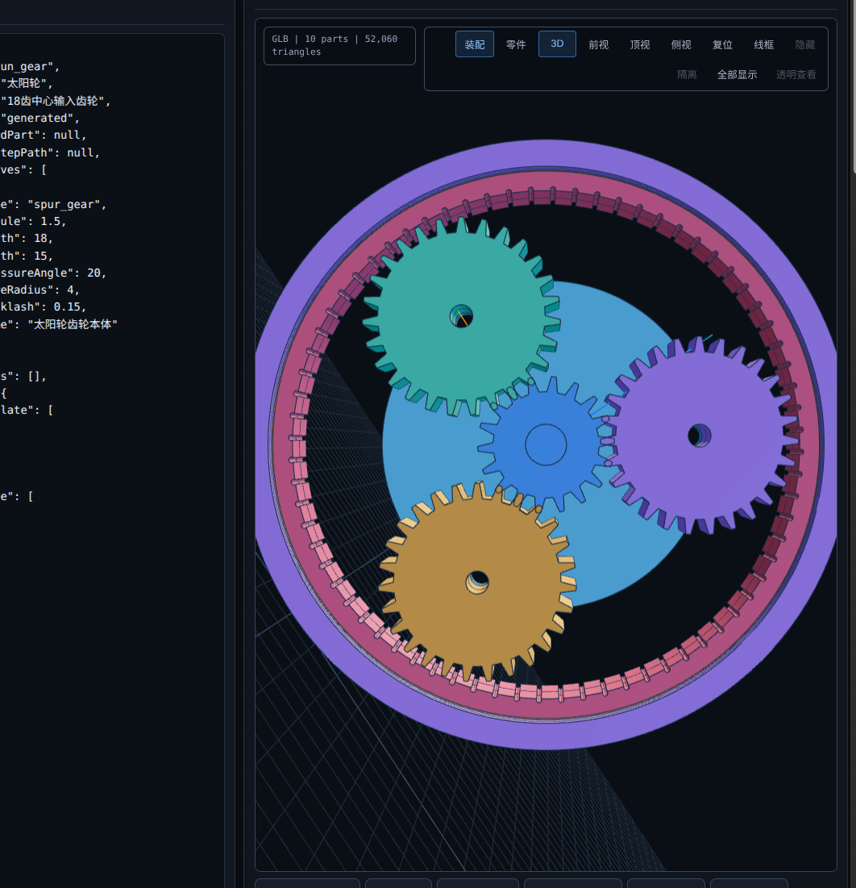

# AI-CAD

**A local workbench for AI-assisted parametric CAD and geometry review.**

[简体中文](README.md) · [Getting started](docs/getting-started.en.md) · [Documentation (中文)](docs/README.md)

Build and edit CAD models from text or reference images, inspect the result in 3D, and keep review evidence with each revision.



*Development screenshot. [More examples](docs/examples.md)*

## Features

- Stable feature plans, local parameter edits, and revision history.
- Native NVIDIA USD BRep for supported features; CadQuery/OpenCascade for broader parts and assemblies.
- Combined BRep and visual review, artifact integrity checks, and validation gates.
- Backend-specific precise USD or STEP exports, preview meshes, and optional FreeCAD integration.

**Stack:** Node.js · Three.js · Python · CadQuery/OpenCascade · NVIDIA USD BRep (optional).

## Quick start

Node.js 20+ and Python with `venv`. Linux:

```bash
git clone https://github.com/kkppshuai-svg/ai-cad.git
cd ai-cad
npm ci
bash scripts/setup_cadquery_env.sh
npm start
```

Open `http://127.0.0.1:3101` and load the plate example. [Windows and backend setup](docs/getting-started.en.md)

See the [Chinese documentation index](docs/README.md) for configuration, API, unified review, and USD BRep integration.
