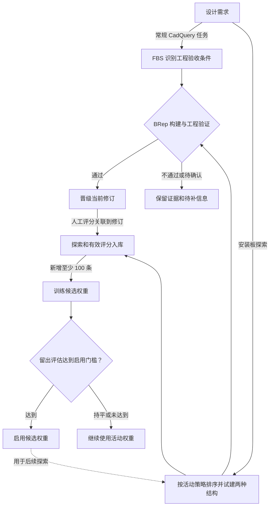

# AI-CAD

**本地 AI 参数化建模与几何审查工作台。**

[English](README.en.md) · [安装与运行](docs/getting-started.md) · [文档中心](docs/README.md)

通过文字或参考图创建和修改 CAD 模型，在三维视图中检查结果，并随修订保留审查证据。

AI-CAD 把 FBS 的行为目标连到工程验证。系统从用户需求中提取明确的验收条件，复用本次 CadQuery 构建的几何事实，给出通过、不通过或待确认。证据不足时，报告会列出需要补充的信息。[自主工程验证与运行示例](docs/autonomous-engineering-verification.md)

离线尺寸策略使用 BRep 重建和工程验收结果计算奖励，并在留出算例上与固定规则比较。[尺寸策略训练与评估](docs/reinforcement-learning.md)

## 从需求到验证和策略更新



安装板入口对比四孔安装板和双调节槽，检查销的全行程干涉和垫圈在行程端点的有效压紧面积。一次已归档的实验完成了 100 个任务、200 次奖励更新。候选与活动策略在 32 个留出案例上均通过 20 个、总奖励持平，本次评估保留活动权重。[结构训练与运行示例](docs/reinforcement-learning.md#从优秀结构样本学习安装方案) · [系统架构](docs/architecture.md) · [工程示例与截图](docs/examples.md)

## 功能

- 稳定特征计划、局部参数修改与版本历史。
- NVIDIA USD BRep 原生建模；更广的零件与装配使用 CadQuery/OpenCascade。
- BRep 与视觉联合审查、产物完整性检查及验证门禁。
- 按后端导出精确 USD 或 STEP，提供预览网格及可选 FreeCAD 接入。

**技术栈：** Node.js · Three.js · Python · CadQuery/OpenCascade · NVIDIA USD BRep（可选）。

## 快速开始

需要 Node.js 20+、支持 `venv` 的 Python。Linux：

```bash
git clone https://github.com/kkppshuai-svg/ai-cad.git
cd ai-cad
npm ci
bash scripts/setup_cadquery_env.sh
npm start
```

打开 `http://127.0.0.1:3101`，加载带孔板示例。[Windows 与后端配置](docs/getting-started.md)

## 文档

- [配置](docs/configuration.md) · [HTTP API](docs/api.md)
- [统一审查](docs/unified-brep-review.md) · [USD BRep 接入](docs/usd-brep.md)
- [开发与测试](docs/development.md) · [问题反馈](https://github.com/kkppshuai-svg/ai-cad/issues)

## 相关项目

- [FormaLatent · 形潜](https://github.com/kkppshuai-svg/formalatent)：CAD 神经表征与相似检索。
- [USD BRep Review](https://github.com/kkppshuai-svg/usd-brep-review)：独立原生 BRep 与视觉审查通道。

项目处于工程研发阶段，审查结果不能替代实际载荷或制造验证。参见[验证范围](docs/validation-and-repair.md)。
