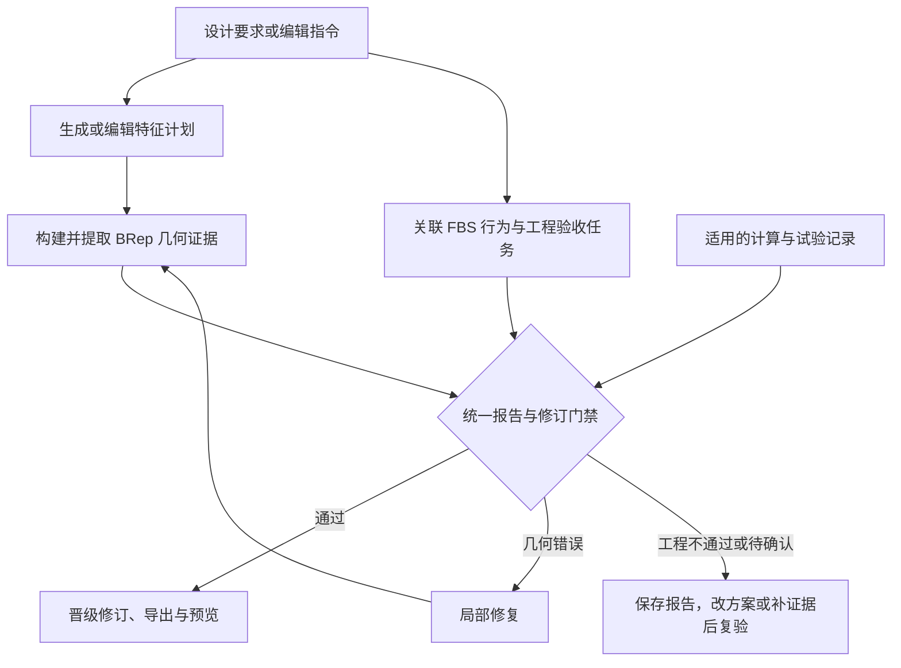

# 系统架构

## 1. 架构目标

AI-CAD 用参数化计划表达设计、用 BRep 构建提供几何证据，并根据同一份审查报告决定候选能否成为当前修订。系统从用户消息识别验收目标、限值与工况，将任务关联到匹配的 FBS 行为和验收条目。CadQuery 直接把本次 BRep 事实交给工程判断，沿用已有的修订门禁和报告。

## 2. 逻辑链路



工程核查与实际用途确认各自给出逐项证据，与几何门禁共同控制晋级。支持范围和调用方式见[自主工程验证](autonomous-engineering-verification.md)。

安装板探索用活动策略安排两种结构的试建顺序，按实际夹具证据筛选后，将所选计划交给同一套构建和修订门禁。反馈训练在后台运行。候选策略通过留出回归后才有资格启用。VAE 样本学习保留自己的队列。[策略更新示意图](../README.md#从需求到验证和策略更新) · [强化学习运行说明](reinforcement-learning.md)

## 3. 权威数据

| 数据 | 权威来源 | 说明 |
| --- | --- | --- |
| 设计意图 | 当前用户消息 + 统一 `concept` | 历史和学习样本不能覆盖明确输入 |
| 参数化模型 | `feature-plan.json` / 当前修订中的 plan | STEP、STL、GLB 不是编辑权威源 |
| 当前版本 | revision store 中已晋级修订 | 失败候选不得替换当前版本 |
| 几何事实 | CadQuery/OCP 构建器输出的验证报告 | UI 不自行猜测尺寸或拓扑 |
| 工程验收条件 | 从用户消息提取并关联 FBS，或由请求显式指定 `engineeringVerification` | 随参数化计划和修订保存，显式条件优先 |
| 验收状态 | `ai-cad-validation-report-v1` | 记录几何状态及已启用的工程决策；工程子报告保留需求、证据及原因 |
| FBS 追溯 | `ai-cad-concept-cad-contract-v1` 归档 | 后续规划只消费紧凑摘要 |
| 安装板活动策略 | `workspace/rl/mount-active.json`，默认使用 `models/mount-active.json` | 仅在留出评估达到更新门槛后替换活动权重 |

## 4. 模块边界

| 模块 | 主要职责 |
| --- | --- |
| `server.js` | HTTP/SSE、运行时依赖、路由装配、服务生命周期 |
| `api-routes.js` | API 路由表与匹配规则 |
| `cad-search.js` | 本地资料、外部搜索回退和不可信资料过滤 |
| `assembly-plan.js` | 装配计划、标准件、位姿和关节校验 |
| `runtime-process.js` | 环境加载、子进程白名单、超时和输出限制 |
| `cadquery-example.js` | 用正式构建器保存和重建优秀样本 |
| `conversation-turn.js` | 单轮规划、FBS 上下文和修复编排 |
| `llm-provider.js` | Codex/DeepSeek 路由与回退策略 |
| `prompt-contract.js` | Concept-CAD、编辑补丁和修复提示合同 |
| `fbs-verification.js` | 将用户的验收条件映射为可追溯的 FBS 工程验证任务 |
| `parametric-plan.js` | 特征计划规范化与 checksum |
| `parametric-edit.js` | 局部编辑补丁和依赖保护 |
| `parametric-api.js` | 参数化 API、增量重建和修订锁 |
| `assembly-build.js` | 候选修订的构建、验证和晋级流程 |
| `cad-validation.js` | 报告合并、门禁、问题分类和确定性修复 |
| `assembly-validation-report.js` | 汇总几何和工程证据，形成统一报告 |
| `validation-repair-loop.js` | 有界的构建—审查—修复循环 |
| `revision-store.js` | 候选、失败、当前修订和回退状态 |
| `scripts/cadquery_build.py` | CadQuery/OCP 几何构建与 STEP 回归验证，提供已构建 BRep 的事实 |
| `scripts/engineering_verification.py` | 按需求选择工程检查，根据证据充分性给出逐项决策 |
| `scripts/cad_rl.py`、`cad_rl_env.py`、`cad_rl_policy.py` | 离线、有界的 CAD 编辑策略训练、对照评估及已核查候选导出；不写修订 |
| `scripts/structure_rl.py`、`mount_learning.py` | 提取安装结构、验证夹具几何、执行探索及带留出门禁的反馈训练 |
| `cad-latent-training.js` | 已通过样本的队列、数据集和 VAE 训练连续性 |
| `public/` | 对话、工程预览、特征树、审查和修订 UI |

## 5. 修订生命周期

```text
计划 → 候选 → 构建 → 审查
                  ├─ 通过 → 当前修订
                  ├─ 几何错误 → 修复后重新审查
                  └─ 工程待确认或不通过 → 保留报告 → 补证据或改方案后复验
```

每个写操作使用当前修订作为基线。陈旧基线返回 `STALE_REVISION`，避免并发修改覆盖新版本。未受影响零件只有在计划 checksum、构建策略 checksum 和 STEP 文件 checksum 均匹配时才允许复用。

## 6. 运行时目录

| 目录 | 内容 | Git 策略 |
| --- | --- | --- |
| `assemblies/` | 装配任务、修订、产物和验证证据 | 忽略 |
| `workspace/uploads/` | 对话参考图 | 忽略 |
| `workspace/latent-learning/` | latent/VAE 运行数据 | 忽略 |
| `workspace/rl/` | 探索与评分事件、运行时活动权重、候选权重及评估报告 | 忽略 |
| `renders/` | 预览渲染 | 忽略 |
| `logs/` | 服务日志 | 忽略 |
| `standard-parts-cache/` | step.parts 缓存 | 忽略 |
| `aicad-fbs-experiments/` | Concept-CAD 追溯归档 | 按研发策略管理 |

## 7. 运动学边界

运动学关系使用 `assembly-constraints.json` 和 `assembly-kinematics.json` 表达，并可通过 FreeCAD 桥接继续处理。核心构建不依赖外部机器人描述或仿真运行时。

仓库内的交互式架构源位于 `docs/architecture/aicad.architecture.json`；生成页面为 `public/architecture.html`。
